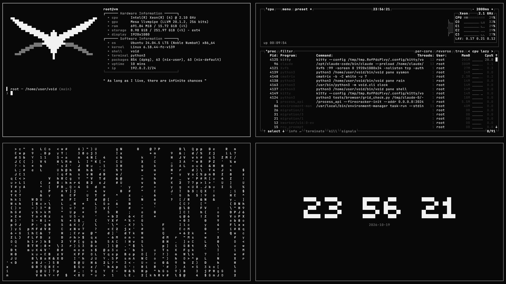

# VOID

A monochrome, Code Geass-inspired workstation for **Nobara Linux · KDE Plasma · Wayland**, across both monitors.
VOID restyles KDE Plasma, Konsole and Spotify (through Spicetify) in one strict black-to-white
palette. It also adds a five-pane terminal dashboard on the right-hand monitor with the Geass
fastfetch, a system monitor, data rain, a clock, and Spotify's now playing with synced lyrics.

It lives alongside **Crimson Desktop**. Switching between the two is journaled and reversible:
`void deactivate` puts back exactly what was there before, Crimson included.



*The default **grid** dashboard: one Kitty window on the right-hand monitor, four bordered tiles —
Geass fastfetch + live shell, btop, matrix rain, clock. Captured from a real Kitty at 1920×1080 in the
build container (no compositor there; on your desktop the tiles are translucent over the wallpaper).
It opens by itself at every login while VOID is active. The older five-pane layout with now playing
and synced lyrics is `[dashboard] layout = "music"`.*

> **How this was built and tested.** VOID was written in a cloud container that could not reach
> your PC. Everything below was run there, against test doubles of KDE's tools, systemd, Konsole,
> Spotify's install folder and Spicetify, and against real tmux, btop, fastfetch, D-Bus and CAVA.
> Nothing has run on your actual Plasma session yet. Start with `void inspect` (read-only). See
> [docs/TESTING.md](docs/TESTING.md) for exactly what was and wasn't verified.

## Install

Full step-by-step guide: **[docs/INSTALL.md](docs/INSTALL.md)**. In short:

```bash
git clone https://github.com/shura-mp3/void.git ~/Projects/void && cd ~/Projects/void
bin/void install      # checks dependencies; asks before any `sudo dnf install` (official repos only)
bin/void inspect      # read-only report: Plasma, monitors, Konsole, Spotify/Spicetify, Crimson
bin/void activate     # backs up first, then applies VOID; undo any time with `void deactivate`
```

## Everyday commands

| | |
|---|---|
| `void activate` / `void deactivate` | switch VOID on / back to what you had before (e.g. Crimson) |
| `void restore` | back to the desktop as it was before VOID was **ever** activated (`--uninstall` also removes VOID's files) |
| `void launch` / `void stop` | open / close the dashboard on the right-hand monitor |
| `void profile minimal\|balanced\|showcase` | performance level (default **balanced**); GameMode drops to minimal automatically |
| `void music` | now playing + synced lyrics in any terminal (also the dashboard's bottom pane) |
| `void lyrics` · `void kitty lyrics` | full-page synced lyrics (Crimson's Kitty lyrics view, ported) — **Meta+Alt+L** |
| `void kitty [shell\|music\|cava\|fetch\|dashboard]` | Kitty in VOID mode, without touching kitty.conf ([docs/KITTY.md](docs/KITTY.md)) |
| `void wallpaper` · `void wallpaper verify` | plan both screens' wallpapers · read them back from Plasma |
| `void toggle` · `void offset ±100` · `void profile next` | what Meta+Alt+D / ] [ / P run |
| `void fetch` | the Geass fastfetch |
| `void status` · `void health` | state · problems (duplicate processes, conflicts, drift) |
| `void spotify inspect\|status\|apply\|revert\|install-spicetify` | the Spotify part on its own |
| `void autostart on\|off` | open the dashboard at login (only while VOID is active) |

The same entry points also exist as `scripts/{inspect-system,install,activate,deactivate,launch,launch-kitty,stop,restore,health-check}.sh`.

**Music pane keys:** `space` play/pause · `n`/`p` next/previous · `←`/`→` seek 5 s · `+`/`-` lyric
offset ±100 ms (saved per track) · `0` reset · `r` refetch lyrics · `f` cycle profile · `q` quit.
In the dashboard, `Ctrl+B r` restarts all panes and `Ctrl+B m` jumps to the music pane.

## What `void activate` changes, and how it's undone

Every setting below is written to the journal *before* it is changed (see
[docs/SWITCHING.md](docs/SWITCHING.md)).

| area | change | note |
|---|---|---|
| Crimson | `crimson-core` / `crimson-dashboard` paused | so only one process ever watches Spotify; restored afterwards |
| colours | **VOID Monochrome** colour scheme, accent from the scheme | KDE colour schemes are global: they apply to both monitors |
| Plasma style | Breeze, which takes its colours from the scheme | panels, task manager, launcher, tray and notifications turn monochrome |
| windows | Breeze decoration, tiny borders, neutral shadows, animation speed 0.7 | |
| cursor | a monochrome cursor theme, only if one is already installed | nothing is downloaded |
| wallpapers | **both monitors**: a panorama split by the real monitor geometry, a matched pair, or one image per screen — monochrome, each at its monitor's exact resolution, read back from Plasma | originals are only read; `assets/wallpapers/generated/preview.png` shows the result |
| lock screen | blurred monochrome copy | |
| KWin rule | the dashboard window goes to the right monitor, borderless, below other windows | matched by its title `VOID//DASHBOARD` |
| Konsole | VOID becomes the default profile | your other profiles, including Crimson's, are untouched |
| Kitty | VOID's `void.conf` included at the end of `kitty.conf` (3 marked lines) | Crimson's include stays; deactivate removes only VOID's lines |
| shortcuts | Meta+Alt+D/L/P/[/] go to VOID; Crimson's bindings set to none | after the next login; given back on deactivate |
| Spotify | Spicetify theme **VOID**, Full App Display, VOID sidebar page | Crimson's custom app is set aside while VOID is active |

Never changed: resolution, refresh rate, scaling or monitor arrangement; your shell rc files;
Crimson's source and git history; KWin and Plasma themselves; SDDM.

## How it fits together

```
Spotify ──MPRIS/D-Bus──▶ void-core ◀── local .lrc → cache → Crimson's cache (read-only) → LRCLIB
PipeWire ─── CAVA ─────▶ (one process, ──unix socket──▶ dashboard music pane, `void music`
/proc, /sys, GameMode ─▶  systemd user) ◀─ws://127.0.0.1:47812── Spotify (VOID theme.js + VOID page)
```

* **void-core** is Crimson's proven backend adapted for VOID (its own socket, port and profiles).
  Activation pauses crimson-core, so there's never a second watcher or a duplicate lyric fetch.
  Lyrics Crimson already downloaded are reused without contacting LRCLIB again.
* **Dashboard:** Konsole runs the *VOID Dashboard* profile, attached to a tmux session on VOID's
  own tmux server and config (your `~/.tmux.conf` is never read). Text is drawn by Konsole's font
  engine at the monitor's real resolution, so it's sharp at every scale. Panes restart themselves
  if they exit, and re-fit when the window size changes, so btop always gets its 80×24 minimum.
* **Konsole everywhere else:** the *VOID* profile starts `bin/void-shell`. It loads your normal
  `~/.bashrc` / `~/.zshrc` / fish config first, then adds VOID's prompt, aliases (`vfetch`,
  `vmusic`, `vdash`) and one fastfetch per window. tmux is never started automatically. For a
  plain shell: `VOID_PLAIN=1 konsole`.
* **Design tokens:** every colour comes from [`config/tokens.toml`](config/tokens.toml).
  `void tokens build` regenerates the Konsole, KDE, Spicetify, btop, tmux, Alacritty, CAVA and
  fastfetch palettes. A test fails if any file in the repo uses a colour that isn't a pure grey.

More detail: [docs/ARCHITECTURE.md](docs/ARCHITECTURE.md) ·
[docs/SPOTIFY.md](docs/SPOTIFY.md) · [docs/SWITCHING.md](docs/SWITCHING.md) ·
[docs/TROUBLESHOOTING.md](docs/TROUBLESHOOTING.md).

## Performance profiles

| | rain | music redraw | spectrum (CAVA) | btop | fetch refresh |
|---|---|---|---|---|---|
| minimal | static | 4 fps | off | 3 s | never |
| **balanced** | 10 fps | 10 fps | 30 fps | 2 s | 10 min |
| showcase | 20 fps | 20 fps | 45 fps | 1 s | 5 min |

Redraws are diffed, so an unchanged pane writes nothing. CAVA runs only while something is showing
the spectrum and music is playing. Measured in the container: [docs/TESTING.md](docs/TESTING.md#performance).

## Tests

```bash
cd tests && python3 -m unittest discover -v     # needs: tmux, node; optional: dbus-run-session, zsh, btop
```

## Repository layout

```
bin/            void (CLI), void-shell (Konsole profile command, POSIX sh)
src/void/       void-core backend (core, mpris, lyrics, lrc, audio, sysinfo, bridge, client),
                tokens, config
  dashboard/    tmux session + panes (music, clock, rain, sysmon, fetch), block font, terminal toolkit
  integration/  journal, switch, kde, konsole, wallpaper, monitors, spotify, services, system, files
config/         tokens.toml, void.toml (documented defaults), generated palettes, tmux, shell layers
spicetify/      Themes/VOID (color.ini, user.css, theme.js), CustomApps/void
assets/         Geass sigil (ascii/), procedural fallback wallpaper
scripts/        the task's entry points (thin wrappers around bin/void)
tests/          unit + sandbox lifecycle tests, test doubles (stubs/), fake Spotify MPRIS, mock LRCLIB
docs/           architecture, switching, Spotify, testing, troubleshooting
```
