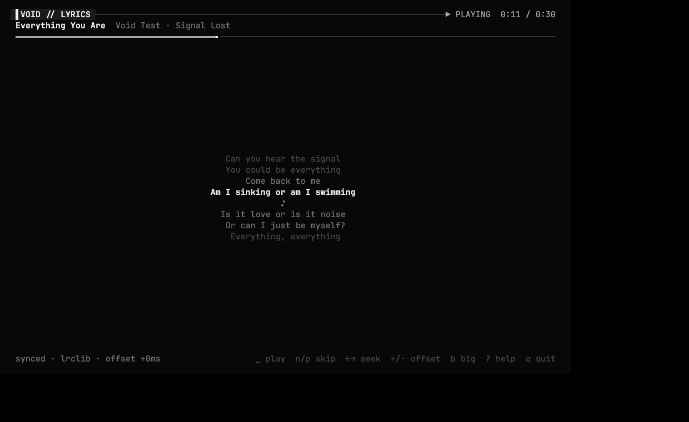

# Kitty in VOID



*Real Kitty 0.32 running `void lyrics` with VOID's generated config, under a virtual X display,
fed by the real void-core and a fake Spotify. 0 of 942,400 pixels are non-grey.*

## Use it

```bash
void kitty                 # Kitty in VOID mode (also: scripts/launch-kitty.sh)
void kitty lyrics          # full-page synced lyrics            — Meta+Alt+L, or Ctrl+Shift+L in Kitty
void kitty music           # now playing + spectrum
void kitty cava            # VOID CAVA spectrum
void kitty fetch           # Geass fastfetch
void kitty dashboard       # the five-pane dashboard in Kitty instead of Konsole
```

`void kitty …` starts Kitty with **your** `kitty.conf` first and VOID's `~/.config/kitty/void.conf`
on top (`kitty --config kitty.conf --config void.conf`). It works whether or not VOID is active and
never edits `kitty.conf`.

While VOID **is active**, every Kitty window is VOID: activation appends a marked three-line block
at the end of `kitty.conf`:

```
# >>> VOID — added by `void activate`, removed by `void deactivate` (keep it last: later lines win)
include void.conf
# <<< VOID
```

Kitty applies settings in order, so this overrides everything above it, including Crimson's
`include crimson.conf`, which stays where it is. Deactivation removes only those three lines. The
rest of `kitty.conf` is untouched, edits you made in the meantime included. `kitty.conf` is also in
the config archive taken before every activation. Running Kitty windows reload instantly (SIGUSR1).
Turn the switch off with `[kitty] enabled = false`.

Konsole is unchanged: it keeps the VOID profile, the dashboard, tmux and the fastfetch Geass.
Kitty doesn't replace it. The dashboard uses Kitty only with `[dashboard] terminal = "kitty"` or
`void kitty dashboard`.

## Feature inventory: Crimson Desktop → VOID

Taken from Crimson's source (`themes/kitty/crimson.conf`, `crimson/tui.py`, `bin/crimson-lyrics`,
`bin/crimson-cava`, `bin/crimsonfetch`, `crimson/ctl.py`, `applications/*.desktop`,
`scripts/apply-theme.sh`), commit `a504041`.

| Crimson feature (where) | VOID | how |
|---|---|---|
| Kitty theme: palette, cursor, selection, URL, marks (`crimson.conf`) | **adapted** | `config/kitty/void.conf.in`, generated from `tokens.toml` (monochrome) |
| JetBrains Mono, size, `disable_ligatures cursor` | **reused** | size from tokens (11) |
| padding, border width/colours, `inactive_text_alpha` | **adapted** | VOID greys |
| layouts `splits,stack,tall`, remembered size, initial 110×32, close confirmation | **reused** | |
| cursor trail (`cursor_trail`, `cursor_trail_decay`) | **reused** | needs Kitty 0.37+; older Kitty ignores the two lines |
| background opacity 0.88 + `background_blur 24` | **adapted** | opacity 0.96, **blur 0** (the brief asks for minimal blur) |
| per-profile opacity file `crimson-profile.conf` (performance → 1.0) | **adapted** | `void-profile.conf`; `void profile minimal` → 1.0, others 0.96; live reload |
| tab bar (powerline, slanted, crimson active tab) | **adapted** | flat `separator` style with `│`, VOID greys |
| shortcuts: splits, new tab, neighbour navigation, stack toggle, opacity `ctrl+shift+a>m/l/1/d`, `ctrl+shift+f5` reload | **reused** | identical keys |
| `ctrl+shift+l` → `crimson-lyrics` | **adapted** | → `void lyrics` (void-core) |
| `ctrl+shift+v>c` → `crimson-cava` | **adapted** | → `void cava` (`config/cava/void`, grey gradient) |
| `ctrl+shift+i` → `crimsonfetch` | **adapted** | → `void fetch` (Geass) |
| — | **new** | `ctrl+shift+m` music pane overlay, `ctrl+shift+d` open the dashboard |
| `crimson-lyrics` TUI (`tui.py`): scrolling page, karaoke with underlined active word, 2× line via Kitty text sizing (`b`, Kitty ≥ 0.40), compact mode, unsynced scroll (`j/k`), help (`?`), offsets, seek, play/pause, reload, redraw only on change, synchronized updates | **ported** | `void lyrics` (`src/void/dashboard/lyrics.py`): same keys and behaviour, VOID palette |
| big line outside Kitty ≥ 0.40 | **new** | falls back to VOID's block font (works in Konsole too) |
| line changes | **new** | short fade on the new line (a terminal can't scroll by fractions of a line) |
| `crimson-lyrics` embedded-core fallback (silent) | **changed** | only with `--embedded`: a silent second core could run next to crimson-core (two Spotify watchers) |
| `crimsonctl lyrics` (opens lyrics in Kitty, class `crimson-lyrics`) | **adapted** | `void kitty lyrics` (class `void-lyrics`) |
| `.desktop` launcher "Crimson Lyrics" + Meta+Alt+L | **adapted** | `void-lyrics.desktop` + Meta+Alt+L (Konsole fallback if Kitty is missing) |
| Meta+Alt+D / P / [ / ] (`crimsonctl toggle / profile next / offset`) | **adapted** | `void toggle`, `void profile next`, `void offset ±100` on the same keys |
| `apply-theme.sh`: KWin blur on for Kitty | **not ported** | VOID keeps blur off |
| `crimson-profile.conf` written by Crimson profiles | **not touched** | VOID writes its own file; Crimson's stays as it is |
| Kitty lyrics album art | **didn't exist** | Crimson's Kitty view never drew art (its Terminal OS draws art in Konsole) |
| `b` 2× text in Kitty < 0.40 | **incompatible** | the protocol needs 0.40+; VOID uses the block font there |

Nothing in Crimson's source runs a visualizer or animation *inside* Kitty other than `crimson-cava`,
which VOID has as `void cava`.

## Shortcut handover

Crimson's Meta+Alt keys run `crimsonctl` / `crimson-lyrics`. Pressed while VOID is active, they would
start crimson-core next to void-core. Activation sets Crimson's five bindings to `none` and puts VOID's
on the same keys (journaled). Deactivation gives them back. KDE's shortcut service reads
`kglobalshortcutsrc` when you log in, so **the swap is complete after the next login**. Turn it
off with `[kde] shortcuts = false`.
